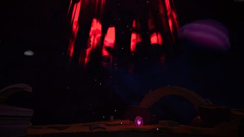
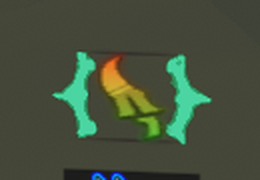
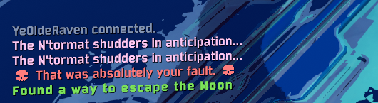

# WhereToDie


Risk of Rain 2 BepInEx plugin: quality of life for the Page of Reincarnation (Hallowed Concepts).
The user-facing description (also the Thunderstore README) is in [README_MOD.md](README_MOD.md).

| | | |
| --- | --- | --- |
|  |  |  |
|  |  |   |

## Requirements

- .NET SDK (any version that can build `netstandard2.1`)
- Risk of Rain 2 with Hallowed Concepts, installed through Steam
- An r2modman profile with BepInExPack, HookGenPatcher and Risk Of Options whose `MMHOOK_RoR2.dll` was regenerated
  for the current game version (launch the game once with that profile after an update). The default is `Hallowed Ready`.
- Python 3 with Pillow, only to regenerate the README previews (`make previews`)

## Building

```sh
make build                     # bin/Release/WhereToDie.dll
make install                   # copy into the profile's BepInEx/plugins/ELEVATED-WhereToDie
make package                   # dist/ELEVATED-WhereToDie-<version>.zip, ready to upload to Thunderstore
make test                       # scripted in-game test (two-player split screen); launches the game
make screenshots && make previews  # README screenshots; launches the game
make install PROFILE_DIR="$HOME/.config/r2modmanPlus-local/RiskOfRain2/profiles/Default"
```

Screenshots: `make screenshots` plays a singleplayer showcase run (first person, no HUD, plus two HUD shots) into
`tests/.profile/BepInEx/wdtest/`, and `make previews` turns them into the small images in `docs/screenshots/`.
`tests/run_ingame_test.sh <profile> showcase:stage` retakes only the stage-start shots.

`package.sh` validates the icon (256x256 PNG), the version (thunderstore.conf vs `PluginVersion` in the source),
the description length and the dependency strings, then writes `manifest.json` and zips
`manifest.json`, `icon.png`, `README.md` (from README_MOD.md), `CHANGELOG.md` and the DLL.

To release a new version, bump `VERSION` in `thunderstore.conf`, `PluginVersion` in `src/WhereToDiePlugin.cs`
and `<Version>` in `WhereToDie.csproj`, add a `CHANGELOG.md` entry, then `make package`.

## Layout

| Path | Purpose |
| --- | --- |
| `src/WhereToDiePlugin.cs` | Plugin entry point and config |
| `src/RiskOfOptionsCompat.cs` | In-game settings (soft dependency) |
| `src/ZoneTracker.cs` | Host: which sacrifice zones work right now, as markers for the visuals |
| `src/ZoneNetwork.cs` | Host -> modded client marker sync that never reaches vanilla players |
| `src/AuroraRenderer.cs` | The hallowed shrine aurora over each marker |
| `src/PageIconHighlighter.cs` | Recolours the Reincarnation icon green-yellow / green-red |
| `src/PageFixes.cs` | Host: page with the N'tormat, recharge in the Soulbound Threshold, re-entry |
| `src/ExtraZones.cs` | Host: the rocketship roof and Planetarium zones |
| `src/FinalePath.cs` | Host: after those zones, Obliteration portals instead of the ways back, and no way out of Obliteration |
| `src/AssemblyInfo.cs` | `SearchableAttribute.OptIn` so the game finds the console commands and message handler |
| `tools/make_previews.py` | Turns showcase screenshots into `docs/screenshots/` |
| `tests/TestDriver/` | Test-only plugin: the scripted test and the showcase run (never packaged) |

## Game internals used

| Thing | Where |
| --- | --- |
| Page of Reincarnation | `DLC4Content.Items.PageDie` / `PageDieConsumed` / `PageDieCooldown`, spell `DLC4Content.CursedBookSpells.Die` |
| Sacrifice zones | `CursedBookSacrificeZone` (+ an `IZone`); the ritual is `EntityStates.CursedBook.RitualCircle.Kill` |
| "In a working zone" | buff `CursedBookReadyForSacrifice`, set by `CursedBookBodyBehavior.AlertSacrificeReadyServer` |
| 30 s reroll zone | `CursedBookSacrificeZone_Reroll`, spawned by `DLC4SacrificeZoneSpawner`; a 65536 m `SphereZone` destroyed by a 30 s `Timer` |
| Page recharge | `CharacterMaster.TryPageRegen` on stage start; skipped once when `PageDieCooldown` is present |
| Soul-binding trial | `DLC4CatastropheProvider` (once per run, off after `DLC4ProgressionController.ReaperBossDefeated`) |
| Scenes | `champrush` = Soulbound Threshold, `ultima` = Terminal Lucidity, `moon2`, `voidraid` |
| Aurora | `HallowingShrineBase.prefab` → `mdlShrineCompulsion/Beam` (beam + motes) |

## Server-side design

- **No catalog or network changes.** The new zones are host-only GameObjects (a `CursedBookSacrificeZone` with a plain
  `IZone` MonoBehaviour), never spawned on the network. Gameplay works for vanilla clients.
- **No R2API**, so the mod never appears in the network mod list.
- **Client -> host**: the `wheretodie_hello` console command (ExecuteOnServer). **Host -> client**: message 0x5744,
  sent only to connections that said hello, because a vanilla peer drops the rest of a packet with an unknown message ID.
- `CursedBookSacrificeZone.GetNextScene` rolls `Run.nextStageRng` for reroll zones, so the tracker re-implements the
  validity check instead of calling `IsValidForPlayer`.

Multiplayer paths are listed in [TESTING.md](TESTING.md).
